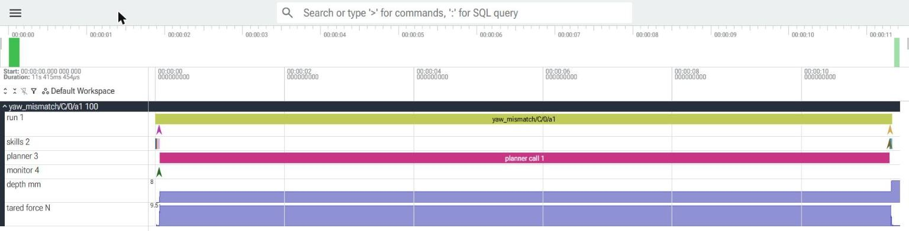

# Phase 3 results: a real model as setting C's planner (#52)

What happened when setting C asked a model on NVIDIA NIM about the failures the Monitor could not
classify, next to the simple policies. Run on 2026-11-09.

**Short answer: the model beat B and C-fixed (62.2% against 33.3%) but not the rule planner
(66.7%).** The gap to the rule planner is within the spread of three repeats (56.7-66.7%). The
model picked the right skill every time it answered on the fixable fault, and never stopped
early on the unfixable one. About 1 call in 4 gave no usable answer: 17 came back empty and 6
were cut at the deadline.

Read this with three limits in mind:

- **The scenarios are ours.** `eval/scenarios/phase3.yaml` (ADR 019) holds two UNKNOWN faults
  that we designed so that their right answers differ. They test whether a planner reads the
  evidence, not whether recovery is worth anything on a real cell.
- **The world is the mock.** While the model thinks, the mock's clock stands still (ADR 016), so
  sim-time columns do not include the model's latency. The latency columns do.
- **A real model is a sample.** The model answers differently from run to run: the C-llm row is
  three repeats of the same eval, and its success rate is given with their spread. Every other
  row is deterministic: the same command gives the same numbers.

## Setup

| | |
|---|---|
| Code | the evals ran at `218893d` (branch `phase3/llm-path`); the report was made with `cellrt agent-report` at `f4f133a` (#51) |
| Model | `nvidia/nemotron-3.5-lightning-30b-a3b` on NIM (`https://integrate.api.nvidia.com/v1`), via the `openai` SDK (ADR 017) |
| Planner settings | defaults: `max_tokens` 1024, deadline 30 s, planner budget 2 calls per task, tool choice `auto` |
| Scenarios | `eval/scenarios/phase3.yaml`: `baseline`, `yaw_mismatch` (fixable: switch to `insert_act`), `damaged_port` (unfixable: stop early) |
| Units | 3 scenarios x seeds 0-9 = 30 per variant; C-llm three times |
| Model calls | 89, capped at 60 per eval (`--max-model-calls 60`) |

Commands, from the repository root, one store per variant:

```sh
S=eval/scenarios/phase3.yaml
uv run cellrt eval --scenarios $S --seeds 10 --k 1 --settings B --db runs/B_1.sqlite
uv run cellrt eval --scenarios $S --seeds 10 --k 1 --settings C --planner rule  --db runs/C-rule_1.sqlite
uv run cellrt eval --scenarios $S --seeds 10 --k 1 --settings C --planner fixed --db runs/C-fixed_1.sqlite
uv sync --extra llm   # and NVIDIA_API_KEY in the environment
for n in 1 2 3; do
  uv run cellrt eval --scenarios $S --seeds 10 --k 1 --settings C --planner llm \
    --max-model-calls 60 --db runs/C-llm_$n.sqlite
done
uv run cellrt agent-report --db B=runs/B_1.sqlite --db C-rule=runs/C-rule_1.sqlite \
  --db C-fixed=runs/C-fixed_1.sqlite --db "C-llm#1=runs/C-llm_1.sqlite" \
  --db "C-llm#2=runs/C-llm_2.sqlite" --db "C-llm#3=runs/C-llm_3.sqlite"
```

The key came from the environment of each `cellrt eval` process only. Each eval's output was
checked for it before it was kept, and none contained it. The six stores (2-3 MB each) are kept
outside the repository; `cellrt replay` and `cellrt trace` read any run in them.

## The agent report

```text
variant  setting  runs             success  wasted_s  wasted_steps  calls/run  invalid  errors  timeouts  p50_s  p95_s  prompt/call  compl/call
B        B          30               33.3%      0.00           0.0       0.00        -       0         0      -      -            -           -
C-rule   C          30               66.7%      2.20           2.0       1.00     0.0%       0         0      -      -            -           -
C-fixed  C          30               33.3%      1.15           1.0       1.33     0.0%       0         0      -      -            -           -
C-llm    C          90  62.2% (56.7-66.7%)      1.24           1.2       0.99    19.1%       0         6  12.77  19.71         1181         769

decisions (valid ones, by kind):
  B: -
  C-rule: retry 10, switch_skill 20
  C-fixed: abort 20, retry 20
  C-llm: switch_skill 66
```

- **wasted**: on runs that failed, the sim time and the skills started from the first UNKNOWN to
  the end.
- **invalid**: answers that failed validation, per call.
- **p50/p95**: wall time of the calls that answered; the 6 calls cut at the 30 s deadline are not
  in them.

## Per scenario

Successful runs:

| scenario | B | C-rule | C-fixed | C-llm (3 x 10) |
|---|---|---|---|---|
| baseline | 10/10 | 10/10 | 10/10 | 30/30 |
| yaw_mismatch (fixable) | 0/10 | 10/10 | 0/10 | 26/30 |
| damaged_port (unfixable) | 0/10 | 0/10 | 0/10 | 0/30 |

What each planner did:

- **B** has no planner: the UNKNOWN ends the task.
- **C-rule** always switches to the other insert skill, then retries. That fixes `yaw_mismatch`
  every time, and spends the whole planner budget on `damaged_port`.
- **C-fixed** retries, then aborts, without reading the evidence. A retry does not fix either
  fault.
- **C-llm** answered with a switch every time it answered: never retry, abort or escalate.
  - On `yaw_mismatch` it chose `insert_act`, the right skill, in all 26 runs where it answered.
    The 4 failures are 3 calls cut at the deadline and 1 empty answer.
  - On `damaged_port` it chose `insert_act` 29 times and then `insert_scripted` 11 times. It
    never stopped early by choice. The runs ended as follows:

    | how the run ended | runs |
    |---|---|
    | its planner budget ran out | 11 |
    | an answer was empty | 16 |
    | a call was cut at the deadline | 3 |

## Bad output

All 17 invalid answers are the same failure.

- **What we saw:** the model returned empty content with `finish_reason: length` and exactly 1024
  completion tokens, the `max_tokens` limit. Nemotron 3.5 Lightning reasons before it answers,
  so the likely cause is that the reasoning used the whole budget before a tool call came out.
  The stores record the token count, not the reasoning itself.
- **The valid answers:** all 66 came back as tool calls (`finish_reason: tool_calls`) with at
  most 1024 completion tokens.
- **No malformed output:** no answer named a skill outside the options or broke the schema.
- **How the runtime handled it:** as Principle 4 asks. Each empty answer was recorded as
  `planner_output_rejected` (`not_json`) and the run ended as aborted. Nothing crashed.

## Cost

Over the 83 calls that came back (the report's columns):

- **Tokens:** about 1,180 prompt tokens and 770 completion tokens per call.
- **Latency:** median wall time 12.8 s, p95 19.7 s.

The 66 valid answers alone were faster and shorter than that: median 11.8 s, p95 18.2 s
(nearest rank), about 700 completion tokens. The 17 empty ones took a median of 16.8 s and all
1024 tokens. The other
6 calls of 89 hit the 30 s deadline and are in neither figure.

In the mock that time is free: the clock stands still while the model thinks. On a cell the arm
holds for it. In the Phase 1 sim run on the GCP VM (#28), the AIC sim ran at about 0.43 of real
time (0.22-0.51 across runs). At that rate a median call is about 5.5 s of sim time, against a
CheatCode task of about 32 s.

## Conclusion

- **The model beat the policies that do not read the evidence, but not the rule planner.** C-llm
  reached 62.2% (56.7-66.7% over three repeats) against 33.3% for B and C-fixed. C-rule reached
  66.7% at no cost; the gap is within the spread of three repeats.
- **What the model did right:** it read the evidence on `yaw_mismatch` and picked the skill that
  twists.
- **What it missed:** it did not see that `damaged_port` cannot be fixed, which is the one
  decision the scenario file was built to test.
- **Don't read the lower wasted time as judgement.** C-llm wasted less sim time than C-rule
  (1.24 s against 2.20 s), but only because 19 of its `damaged_port` runs ended early on a failed
  call (16 empty answers, 3 timeouts).

Two changes would make the next run a fairer test of the model:

- **A larger token limit, or reasoning switched off.** The 17 empty answers come from a setting,
  not from the model's judgement.
- **A clear statement of what we will not change.** The prompt could say more about when to stop,
  but writing the answer to `damaged_port` into the prompt would turn the eval into a test of the
  prompt. We keep the prompt as it is, so the result stays a result about the model.

## Trace

`docs/assets/phase3-trace-yaw_mismatch-C-0-llm1.json` is the Perfetto trace of
`yaw_mismatch/C/0/a1` from `C-llm#1`, on the wall clock (`cellrt trace --clock wall`). Open it at
<https://ui.perfetto.dev>.



On the wall clock the planner call is nearly the whole run. The mock's skills take
milliseconds of wall time, before and after it. The depth and force tracks stay flat through
the call: the arm holds. `--clock sim` draws the same run as the robot saw it, with the call
taking no time.

What the run shows:

1. At 7.2 s of sim time, `insert_scripted` stalls on the injected yaw fault. The Monitor
   classifies the stall UNKNOWN (`insert_stalled`) and preempts the skill.
2. The planner call takes 11.3 s of wall time, while the sim clock stays at 7.2 s.
3. The model answers `switch_skill: insert_act`. The answer passes validation and `insert_act`
   inserts the plug.
4. `verify` confirms the insertion at 10.0 s.
